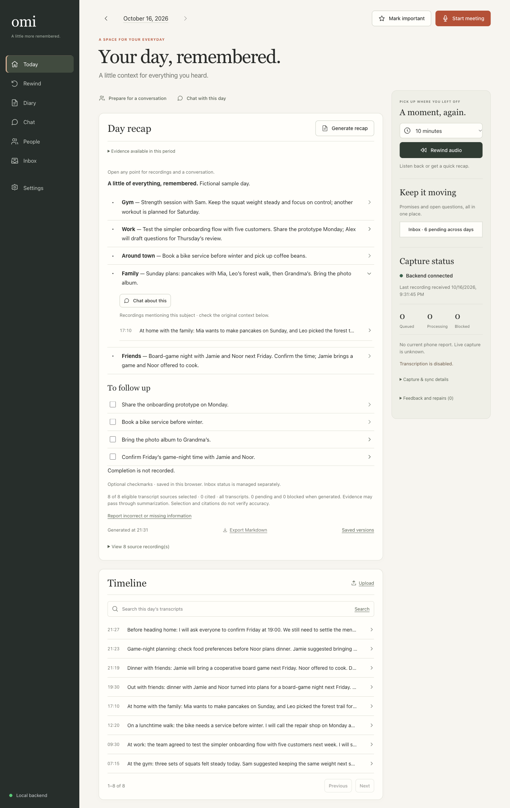
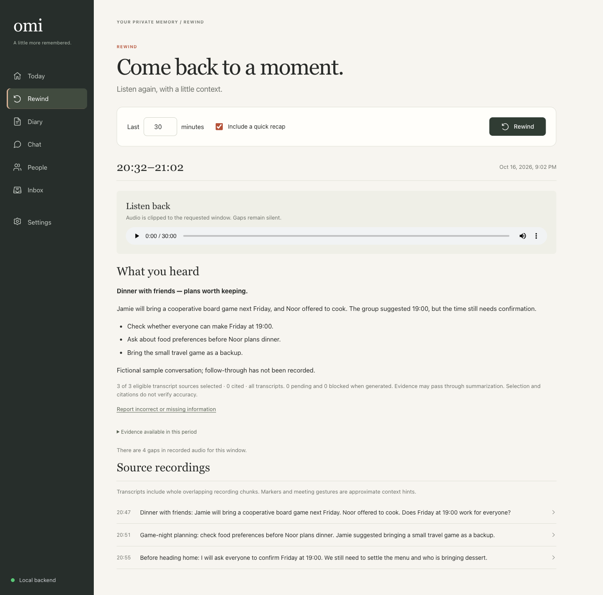
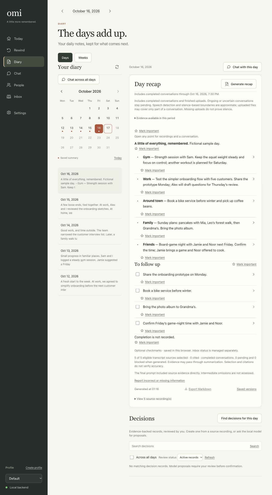
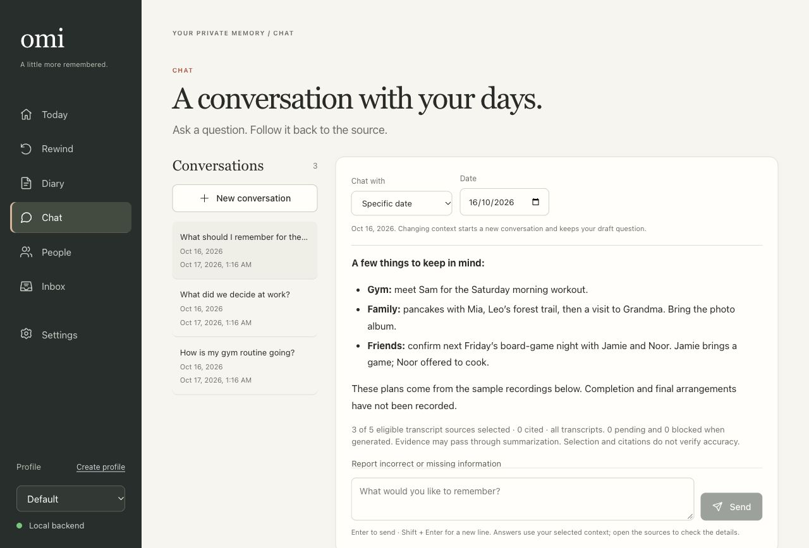
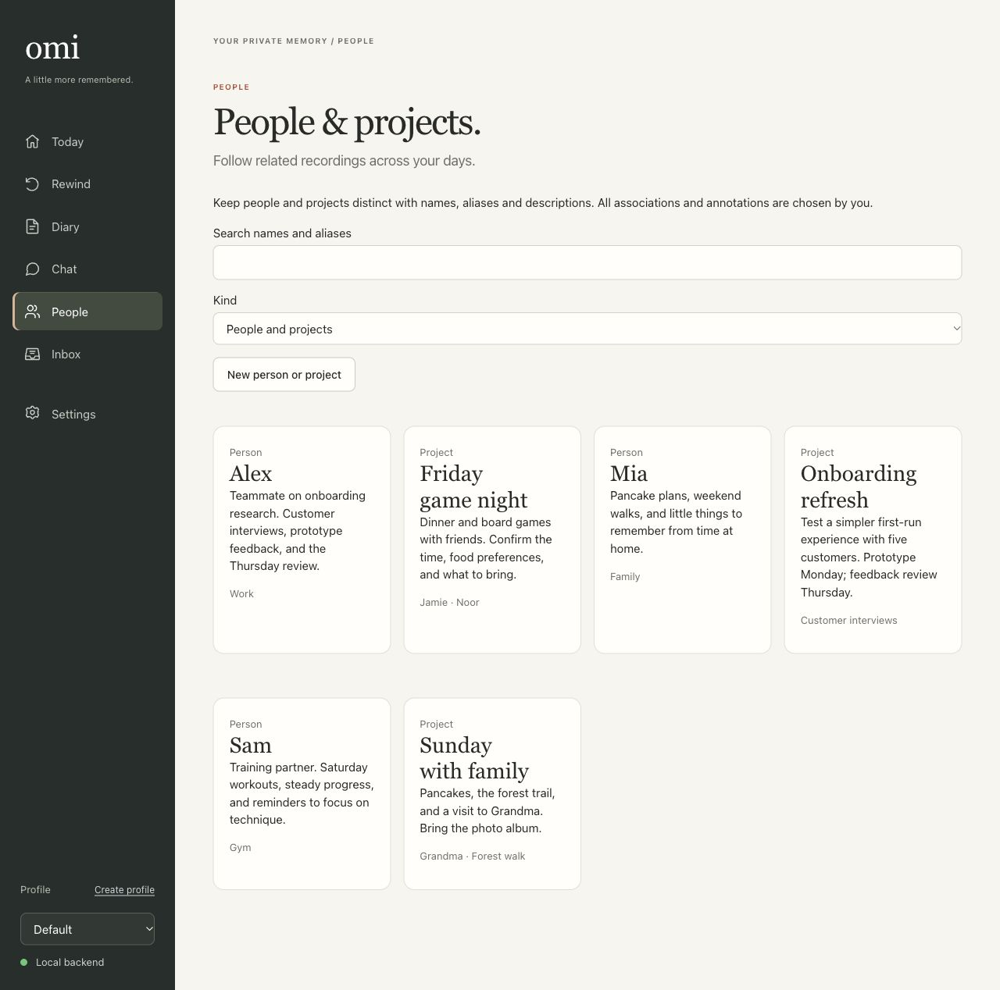
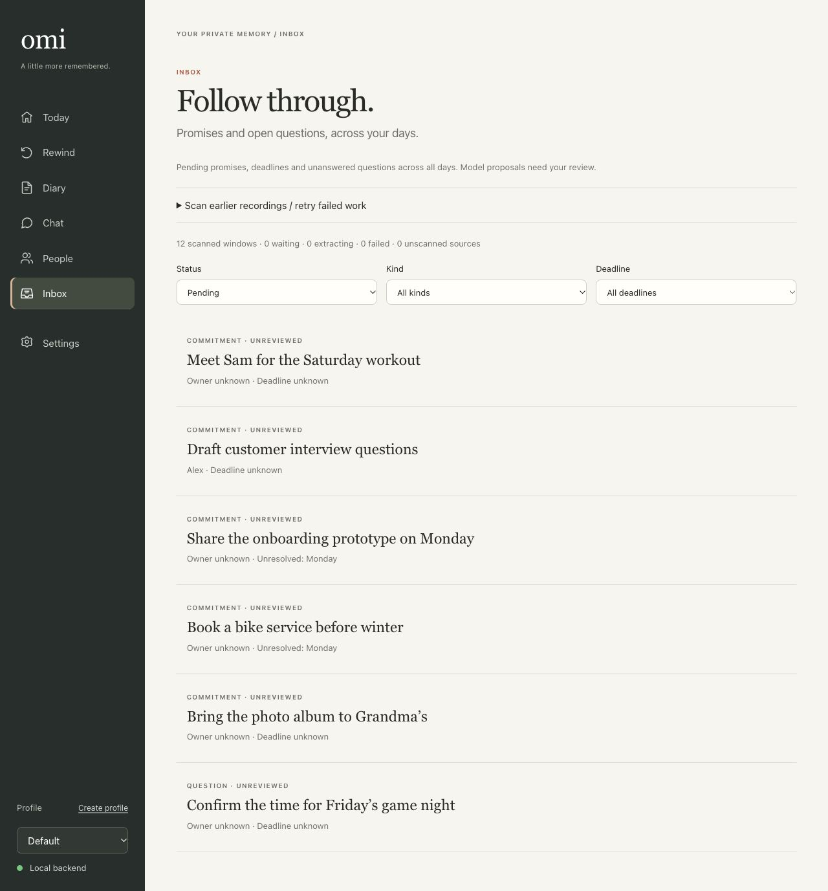
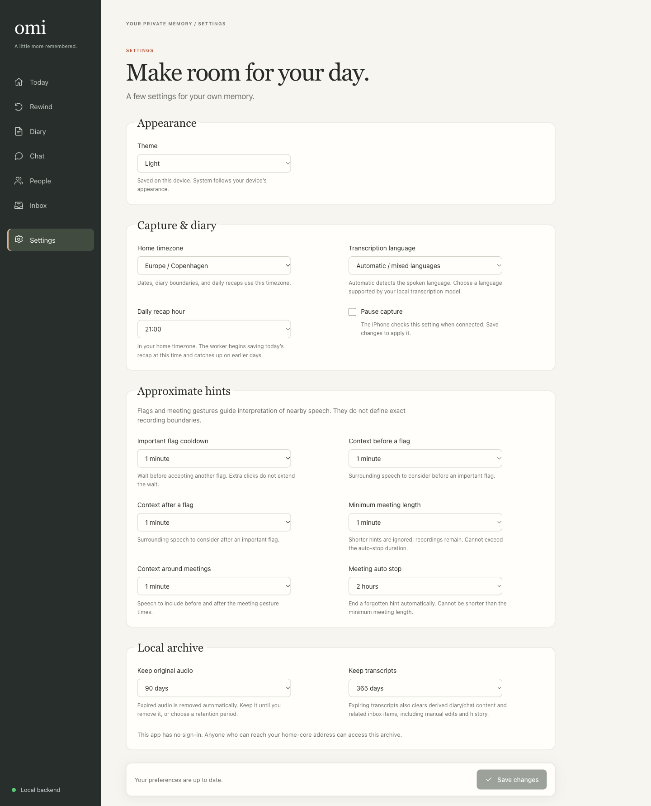
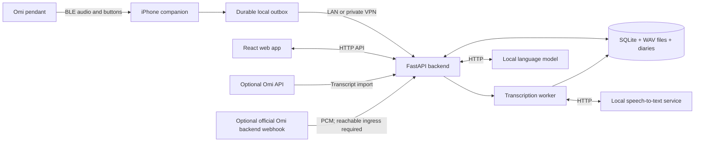

# Omi Local

A private audio memory system: Omi pendant → iPhone → your backend and local AI. Turn recordings into searchable transcripts, daily diaries, meeting notes, and chat with source references. Access your archive through the native companion or responsive web app.

Direct capture needs no Omi account or cloud AI subscription. Existing hosted Omi transcripts can optionally be imported. An optional official-app audio webhook receiver is also available; current upstream sends it from Omi’s backend, so a phone-only LAN/VPN connection is insufficient.



*The Today dashboard with fictional sample recordings from the gym, work, everyday errands, home with family, and time out with friends.*

## Features

- **Capture:** durable offline phone queue, retryable uploads, pause/resume, capture-gap tracking, and optional Wi-Fi-only uploads.
- **Recall:** transcript search and correction, audio rewind, and persistent chat grounded in recorded sources.
- **Diary:** automatic daily recaps, meeting notes, history, and Markdown export.
- **Control:** important-moment flags, meeting controls, configurable retention, and archive backup/restore.

## More screenshots

These pages use fictional sample data spanning work, family, friends, the gym, and everyday errands. Expand a page to see its screenshot.

<details>
<summary>Rewind — revisit plans made over dinner with friends</summary>

A recent audio window, a quick recap, and the original source recordings.



</details>

<details>
<summary>Diary — browse a week of everyday moments</summary>

Saved daily recaps alongside a calendar, covering work, workouts, family time, and social plans.



</details>

<details>
<summary>Chat — remember what is coming up</summary>

A sample conversation about weekend plans, with the related recordings available for inspection.



</details>

<details>
<summary>People — connect recordings to people and projects</summary>

Example labels for a teammate, a training partner, family, an onboarding project, and game night.



</details>

<details>
<summary>Inbox — follow through across all parts of your day</summary>

Sample commitments and an open question from work, the gym, family plans, errands, and friends.



</details>

<details>
<summary>Settings — choose capture, diary, and archive preferences</summary>

Example appearance, timezone, transcription, recap, gesture, and retention settings.



</details>

## Architecture



The SwiftUI/CoreBluetooth companion preserves capture timestamps and IDs across retries. One Python process serves the web app/API and runs background transcription/recaps. SQLite provides keyword/date retrieval; models run in separate local services.

## Hardware and prerequisites

| Component | Requirement |
|---|---|
| Wearable capture | Omi pendant with compatible BLE firmware; supported codecs are PCM16 (`0`) and Opus (`20`/`21`). |
| Phone | iPhone running iOS 17+ with Bluetooth and access to the backend. |
| Backend | Always-on computer/server with persistent storage; Python 3.15.0+, `uv` 0.13.1+, Node.js 26.12.0+ and npm 12.2.0+ for a source install, or Docker Compose. |
| Local AI | Compatible `/audio/transcriptions` and `/chat/completions` HTTP services. Models are not bundled; RAM/GPU requirements depend on your models. |
| iOS development | Mac with Xcode supporting iOS 17+ and signing configured. XcodeGen is only needed to regenerate the included project. |

Browser uploads work without wearable hardware. Decoded audio uses roughly **1.38 GB per 12 hours**, plus compressed originals/metadata. The phone storage budget defaults to 2 GB.

## Installation

### Backend and web app

Use the versions in `.python-version` and `.node-version`; install or upgrade `uv` to at least 0.13.1 and npm with `npm install --global npm@12.2.0`. Both dependency lockfiles are checked in.

Run from the repository root:

```sh
bash scripts/build.sh
uv run python scripts/init_config.py
# Edit .env with your local model endpoints and names before starting.
bash scripts/dev.sh
```

Open **http://localhost:8787** or `http://<server-LAN-address>:8787` from another device. Existing `.env` files are preserved. The launcher binds all interfaces; set `OMI_HOST=127.0.0.1` for access from the server only.

Set these values in `.env`; the example gateway/model names are specific to the original home network:

| Setting | Purpose |
|---|---|
| `OMI_STT_BASE_URL`, `OMI_STT_MODEL` | Local transcription endpoint base (including `/v1`) and model name. |
| `OMI_LLM_BASE_URL`, `OMI_LLM_MODEL` | Local language-model endpoint base (including `/v1`) and model name. |
| `OMI_INFERENCE_TOKEN` | Optional credential for your local inference gateway. |
| `OMI_DATA_DIR`, `OMI_TIMEZONE` | Archive location (default `data/`) and local calendar timezone. |
| `OMI_AUDIO_RETENTION_DAYS`, `OMI_TRANSCRIPT_RETENTION_DAYS` | Independent retention periods; defaults are 7 days for audio and 30 days for transcripts. `0` keeps data indefinitely. |

See [all starter settings](config/omi.env.example). Saved runtime settings override environment defaults.

**Docker alternative:** create `.env` from `config/omi.env.example` if absent, edit the model settings, then run:

```sh
docker compose --env-file .env -f config/compose.yaml up --build -d
```

Docker builds the app and persists the archive in a named volume. Use inference addresses reachable from the container; `localhost` refers to the container itself.

To build and run the backend directly using the root [Dockerfile](Dockerfile):

```sh
docker build -t omi-local .
docker run -d --name omi-local --restart unless-stopped \
  --env-file .env --env OMI_DATA_DIR=/data \
  --publish 8787:8787 --volume omi-local-data:/data omi-local
```

The image includes the web app and runs one backend worker as a non-root user. The volume preserves the archive when the container is replaced; the explicit data directory overrides the source-install path in `.env`.

### Official app audio forwarding (optional)

You can ingest official-format realtime PCM without installing OmiLocal on the phone. Configure a server token, enable **Settings → Omi connection → Official app audio forwarding**, then set the URL and interval in the official app’s **Settings → Developer Mode → Realtime audio bytes**. Accepted chunks enter the local playback/transcription/archive pipeline.

Current upstream sends from **Omi’s backend** and rejects private destinations. A phone reaching this app on LAN/VPN does not establish webhook reachability. Hosted delivery needs an operator-provisioned HTTPS ingress restricted to the receiver POST; the rest of this unauthenticated archive must stay private. No ingress is created by this feature. Receipt-based timing, finite retries and device support limits apply; forwarding does not establish cloud-free or continuous capture. See the [first-use walkthrough, contract evidence and physical checks](docs/official-audio-forwarding.md).

### iPhone companion

1. Open [OmiLocal.xcodeproj](src/ios/OmiLocal.xcodeproj), select your signing team and connected iPhone, and run. Enable Developer Mode if prompted.
2. Allow Bluetooth and local-network access. In app Settings, enter `http://<server-LAN-address>:8787` and use **Save & test connection**.
3. Connect the pendant in Capture. Choose **Double click · stock firmware** for meetings until another gesture is verified; single click marks important moments. On-screen controls are also available.

Keep the backend awake and port 8787 reachable. Away from the server, recordings queue locally and upload after reconnection; summaries/chat require reachable models.

## First use and operation

Check `curl --fail http://localhost:8787/v1/status`, then upload a short recording with its actual start time. Confirm transcription, generate a recap, and ask a question. Status alone does not test model connectivity.

Run **one backend process per archive**. For a source installation:

```sh
uv run python scripts/archive.py backup /path/to/omi-backup.zip
uv run python scripts/archive.py restore /path/to/omi-backup.zip /path/to/new-data-dir
```

Stop the backend before restoring into a new destination, then update `OMI_DATA_DIR`. See [changing the storage location](docs/README.md#change-the-storage-location) for source and Docker migration steps, and [backup details](docs/README.md#archive-and-backup) for encryption.

**Access and limits:** the archive app/API have no authentication (the optional audio webhook requires its own token); use a trusted private LAN or VPN. Physical-device endurance and real model quality still need validation. Device Wi-Fi capture, pendant-storage downloads, semantic embeddings, and speaker identification are not implemented. Markers are approximate context; check generated answers against sources.

## Development and further reading

```sh
uv run pytest
uv run ruff check .
npm --prefix src/web test
npm --prefix src/web run build
(cd src/ios && swift test)
```

For frontend development, run `npm --prefix src/web run dev` alongside the backend. Rebuild afterward with `bash scripts/build.sh`.

Source: `src/omi_local/` (backend), `src/ios/` (companion), `src/web/` (React/TypeScript). Deployment, tooling, and backend tests live in `config/`, `scripts/`, and `tests/`.

[Operations and API guide](docs/README.md) · [Architecture](docs/architecture.md) · [Hardware and acceptance plan](docs/device-research.md) · [Implementation plan](docs/implementation-plan.md)
