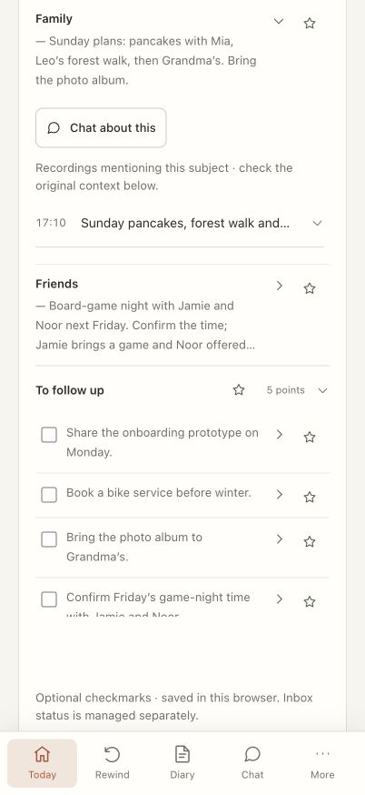
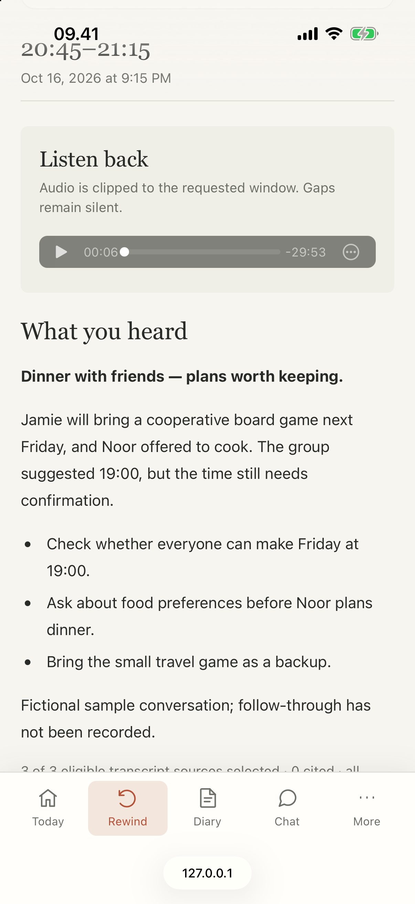
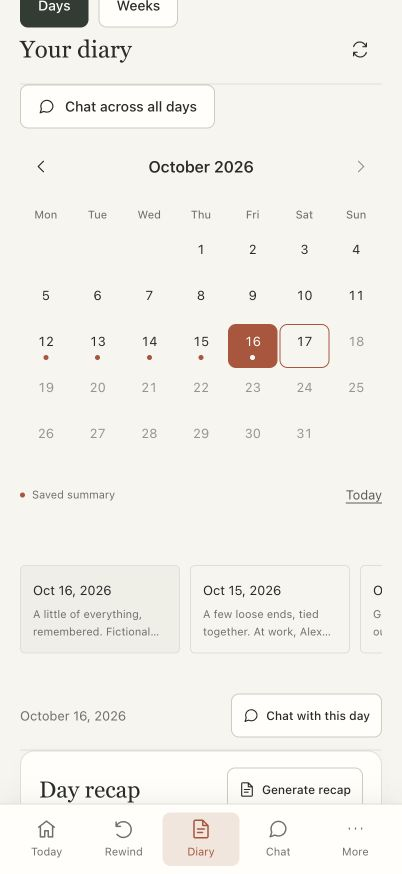
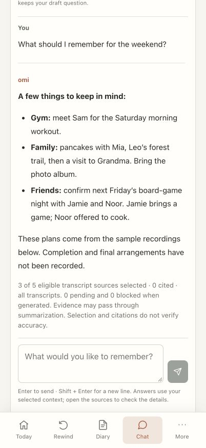
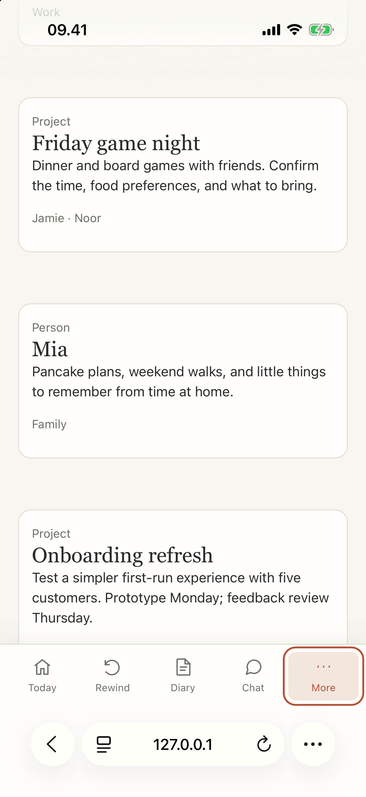
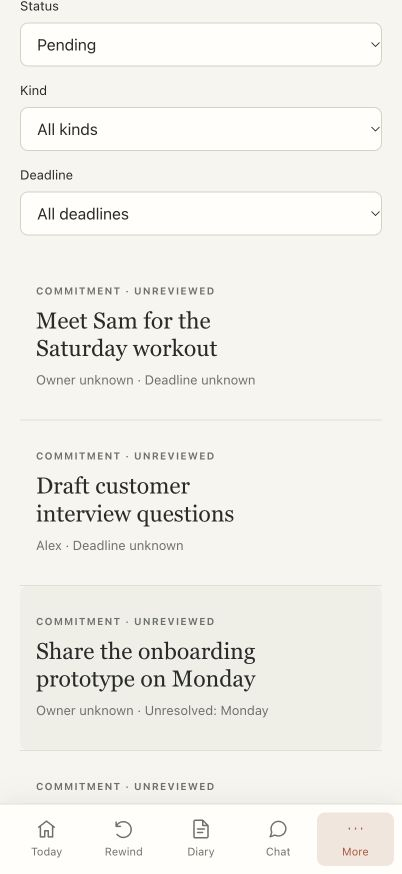
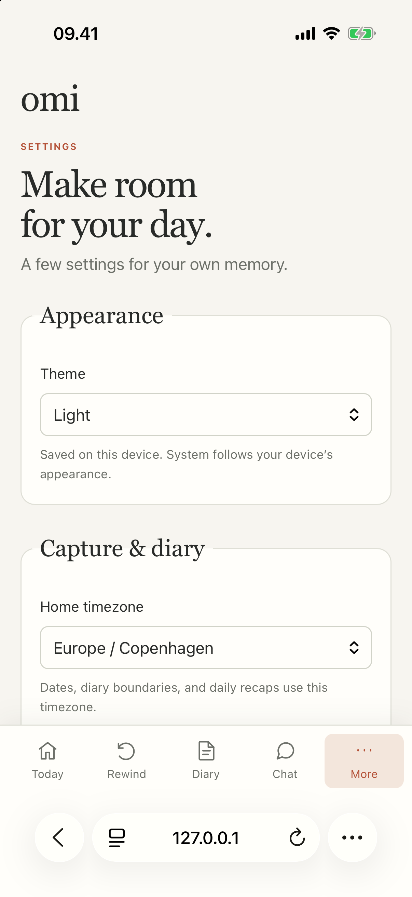
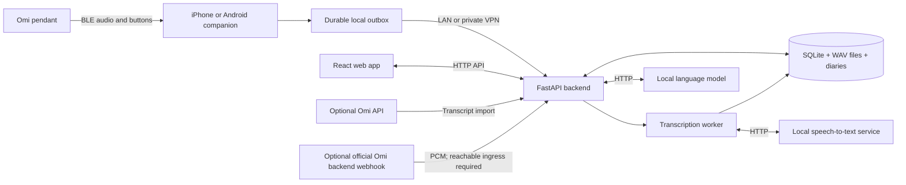

# Daythread

A private audio memory system: Omi pendant → iPhone or Android → your backend and local AI. Turn recordings into searchable transcripts, daily diaries, meeting notes, and chat with source references. Access your archive through the native companion or responsive web app.

Direct capture with local models needs no Omi account or cloud AI subscription. You can also configure compatible hosted HTTPS model endpoints with provider API keys. Existing hosted Omi transcripts can optionally be imported. An optional official-app audio webhook receiver is also available; current upstream sends it from Omi’s backend, so a phone-only LAN/VPN connection is insufficient.

<table>
<tr><th>Desktop</th><th>Mobile · 402 × 874</th></tr>
<tr>
<td width="67%" valign="top"></td>
<td width="33%" valign="top"></td>
</tr>
</table>

*Today on desktop and mobile: expandable recap points with related recordings and a chat action, plus individual follow-up checkboxes. Both views use the same fictional recordings from the gym, work, everyday errands, home with family, and time out with friends.*

Screenshots reflect the current redesign, captured in the Codex browser. Mobile views use a 402 × 874 viewport; longer pages are scrolled to show their sample content.

## Features

- **Capture:** durable offline phone queue, retryable uploads, pause/resume, capture-gap tracking, and optional Wi-Fi-only uploads.
- **Import audio:** add recordings from other phones, computers, and voice recorders through the web app, preserving original start times and filenames.
- **Recording brands:** choose Plaud, Pocket, Apple Voice Memos, Sony or Zoom for exported audio in web and iPhone imports. Web Settings → Connections also imports Pocket cloud transcripts with a backend API key and Plaud SRT/TXT transcript exports. Brands share a [capability catalog and import interface](docs/architecture.md#recording-vendors-and-import-adapters).
- **Recording topics:** automatically generate descriptive titles and expandable topic sections after transcription, including for existing recordings.
- **Recall:** transcript search and correction, audio rewind, and persistent chat grounded in recorded sources.
- **Diary:** automatic daily recaps, meeting notes, history, and Markdown export.
- **Control:** important-moment flags, meeting controls, configurable retention, and archive backup/restore.
- **Conversation tags:** add reusable manual tags, and combine tag and location-zone filters without changing recorded locations. See [tag behavior and API](docs/conversation-tags.md).
- **Locations:** opt-in iPhone GPS tags for conversations, named zones with multiple locations and individual radii for recording filters, and confirmed arrival/departure reminders for places discussed in decision follow-ups. See [location setup and device checks](docs/location-support.md).
- **Languages:** English, Danish, German, Spanish, French, Norwegian Bokmål, and Swedish interfaces on web and iPhone, with a device-level language choice separate from transcription and recap languages.

## Contribute a localization

The web and iPhone apps have English, Danish, German, Spanish, French, Norwegian Bokmål, and Swedish interface catalogs. To add a language, translate the web JSON catalog and iPhone `Localizable.strings`, register the language in each app, then run the catalog check and app builds. See the [localization contributor guide](docs/localization.md) for file paths and steps. The coverage check scans web and native source copy, shared server messages, status labels, and placeholders. New interface text should be added to every catalog; recordings and generated content are not translated by this setting.

## More screenshots

These pages use fictional sample data spanning work, family, friends, the gym, and everyday errands. Expand a page to compare its desktop and mobile views.

<details>
<summary>Rewind — revisit plans made over dinner with friends</summary>

A recent audio window, a quick recap, and the original source recordings.

<table>
<tr><th>Desktop</th><th>Mobile · 402 × 874</th></tr>
<tr>
<td width="67%" valign="top"></td>
<td width="33%" valign="top"></td>
</tr>
</table>

</details>

<details>
<summary>Diary — browse a week of everyday moments</summary>

Saved daily recaps alongside a calendar, covering work, workouts, family time, and social plans.

<table>
<tr><th>Desktop</th><th>Mobile · 402 × 874</th></tr>
<tr>
<td width="67%" valign="top"></td>
<td width="33%" valign="top"></td>
</tr>
</table>

</details>

<details>
<summary>Chat — remember what is coming up</summary>

A sample conversation about weekend plans, with the related recordings available for inspection.

<table>
<tr><th>Desktop</th><th>Mobile · 402 × 874</th></tr>
<tr>
<td width="67%" valign="top"></td>
<td width="33%" valign="top"></td>
</tr>
</table>

</details>

<details>
<summary>People — connect recordings to people and projects</summary>

Example labels for a teammate, a training partner, family, an onboarding project, and game night.

<table>
<tr><th>Desktop</th><th>Mobile · 402 × 874</th></tr>
<tr>
<td width="67%" valign="top"></td>
<td width="33%" valign="top"></td>
</tr>
</table>

</details>

<details>
<summary>Inbox — follow through across all parts of your day</summary>

Sample commitments and an open question from work, the gym, family plans, errands, and friends.

<table>
<tr><th>Desktop</th><th>Mobile · 402 × 874</th></tr>
<tr>
<td width="67%" valign="top"></td>
<td width="33%" valign="top"></td>
</tr>
</table>

</details>

<details>
<summary>Settings — choose capture, diary, and archive preferences</summary>

Daily preferences for appearance, timezone, transcription, and recaps, with separate categories for flags, storage, connections, and local AI.

<table>
<tr><th>Desktop</th><th>Mobile · 402 × 874</th></tr>
<tr>
<td width="67%" valign="top"></td>
<td width="33%" valign="top"></td>
</tr>
</table>

</details>

## Architecture



The SwiftUI/CoreBluetooth iPhone companion and Android native capture service preserve capture timestamps and IDs across retries. Android uses the shared mobile web interface for its archive; see the [Android guide](src/android/README.md). One Python process serves the web app/API and runs background transcription/recaps. SQLite provides keyword/date retrieval; models run in separate local services.

## Hardware and prerequisites

| Component | Requirement |
|---|---|
| Wearable capture | Omi pendant with compatible BLE firmware; supported codecs are PCM16 (`0`) and Opus (`20`/`21`). |
| Phone | iPhone running iOS 17+, or Android 8.0+ with Bluetooth and access to the backend. |
| Backend | Always-on computer/server with persistent storage; Python 3.15.0+, `uv` 0.13.1+, Node.js 26.12.0+ and npm 12.2.0+ for a source install, or Docker Compose. |
| Local AI | Compatible `/audio/transcriptions` and `/chat/completions` HTTP services. Models are not bundled; RAM/GPU requirements depend on your models. |
| iOS development | Mac with Xcode supporting iOS 17+ and signing configured. XcodeGen is only needed to regenerate the included project. |

Browser uploads work without wearable hardware. Decoded audio uses roughly **1.38 GB per 12 hours**, plus compressed originals/metadata. The phone storage budget defaults to 2 GB.

### iPhone backend endpoints

In **iPhone Settings → Backend endpoints**, keep the endpoint for the network you use most often first or mark it active, then add fallbacks with **Add endpoint** and reorder them as needed. For example, a home LAN plus a Tailscale/private-VPN address might be:

```text
https://daythread.home.arpa
https://daythread.tailnet.ts.net
```

Each endpoint can be tested independently. Foreground API requests and background uploads try the active endpoint, then each fallback once when the failure is a DNS/reachability/TLS/network failure or a 502/503/504 gateway response. A successful fallback becomes active for recovery; certificate validation is never disabled. HTTP is supported only for a trusted LAN/VPN and is called out as unencrypted in the app. Keep the backend private; this feature does not publish or authenticate it.

## Installation

### Backend and web app

Use the versions in `.python-version` and `.node-version`; install or upgrade `uv` to at least 0.13.1 and npm with `npm install --global npm@12.2.0`. Both dependency lockfiles are checked in.

Run from the repository root:

```sh
bash scripts/build.sh
uv run python scripts/init_config.py
# Configure STT and LLM connections in Settings → Models & server after starting.
bash scripts/dev.sh
```

Open **http://localhost:8787** or `http://<server-LAN-address>:8787` from another device. Existing `.env` files are preserved. The launcher binds all interfaces; set `OMI_HOST=127.0.0.1` for access from the server only.

Configure models, language/task routes, local endpoints, API keys, embeddings, forwarding and processing options from **web Settings → Models, keys & server settings** or **iPhone Settings → Transcription → Models, keys & all server settings**. Keys are write-only: keep, replace or clear them without displaying the saved value. In Speech-to-text (STT) and Language model (LLM), set the provider API key or choose Use shared key / No authentication. Route keys override provider keys. Hosted transcription receives audio; hosted language models receive prompts and selected transcripts. STT/LLM/key changes apply immediately; embedding, worker and archive-path changes are marked for backend restart. The clients expose all backend `Settings` fields.

Speech processing preserves faint audio by default, applies capped gain to transcription copies,
and retains every sample when splitting requests. Optional local FFmpeg cleanup produces a
separate reading for review beside original playback; candidates never enter search or summaries
until corrected. See [processing settings and acoustic evaluation](docs/README.md#speech-processing-and-cleanup-review)
and the [reviewed plan](docs/audio-processing-plan.md). Simultaneous-speaker separation remains
unimplemented; preserving all voices in the recording does not guarantee their transcription.

Optional [local speaker detection](docs/README.md#speaker-detection-and-names) labels speakers
A, B, C across a meeting or conversation. On web and iPhone, listen to a speaker's turns,
assign a conversation-specific name, and correct or merge assignments. It requires the
separate local model service described in [the configuration example](config/omi.env.example).
Optional [remembered voices](docs/README.md#remembering-speakers-across-conversations) use
explicitly confirmed examples to suggest identities in later conversations. Suggestions
require a passing evaluation on separate real recordings and always need confirmation.

Configure STT and LLM endpoints, API keys, model names, language/task routes and processing options in **Settings → Models & server**. The starter `.env` no longer duplicates these settings. Existing model environment variables remain compatible as startup defaults, with saved settings taking precedence. To remove them from an older installation without losing unsaved defaults, stop the backend and run:

```sh
uv run python scripts/migrate_model_settings.py
```

The migration saves effective model values and keys to private settings before removing only `OMI_STT_*` and `OMI_LLM_*` entries from `.env`. Unrelated entries are preserved. Run it in the same environment and archive location as the backend; for Docker, use the container's archive volume rather than a host-side `data/` directory.

Other environment defaults include `OMI_DATA_DIR` for the archive location, `OMI_TIMEZONE`, and `OMI_HOST`/`OMI_PORT` for the listener. Ordinary preferences are also available in Settings.

See [all starter settings](config/omi.env.example). Saved settings override environment defaults. Service configuration and keys are saved atomically with owner-only permissions in `.private-settings.json` inside the initial archive directory; this file is excluded from application archive exports. Copy it separately when moving the deployment. Changing the archive path selects another archive after restart and does not move recordings.

**Docker alternative:** create `.env` from `config/omi.env.example` if absent, then run:

```sh
docker compose --env-file .env -f config/compose.yaml up --build -d
```

Docker builds the app and persists the archive in a named volume. Use inference addresses reachable from the container; `localhost` refers to the container itself.

To build and run the backend directly using the root [Dockerfile](Dockerfile):

```sh
docker build -t omi-local .
docker run -d --name omi-local --restart unless-stopped \
  --env-file .env --env OMI_DATA_DIR=/data \
  --publish 8787:8787 --volume omi-local-data:/data omi-local
```

The image includes the web app and runs one backend worker as a non-root user. The volume preserves the archive when the container is replaced; the explicit data directory overrides the source-install path in `.env`.

### Official app audio forwarding (optional)

You can ingest official-format realtime PCM without installing Daythread on the phone. Configure a server token, enable **Settings → Omi connection → Official app audio forwarding**, then set the URL and interval in the official app’s **Settings → Developer Mode → Realtime audio bytes**. Accepted chunks enter the local playback/transcription/archive pipeline.

Current upstream sends from **Omi’s backend** and rejects private destinations. A phone reaching this app on LAN/VPN does not establish webhook reachability. Hosted delivery needs an operator-provisioned HTTPS ingress restricted to the receiver POST; the rest of this unauthenticated archive must stay private. No ingress is created by this feature. Receipt-based timing, finite retries and device support limits apply; forwarding does not establish cloud-free or continuous capture. See the [first-use walkthrough, contract evidence and physical checks](docs/official-audio-forwarding.md).

### iPhone companion

1. Open [Daythread.xcodeproj](src/ios/Daythread.xcodeproj), select your signing team and connected iPhone, and run. Enable Developer Mode if prompted.
2. Allow Bluetooth and local-network access. In app Settings, enter `http://<server-LAN-address>:8787` and use **Save & test connection**.
3. Connect the pendant in Capture. Single click defaults to **Mark as important** and double click defaults to **Start / end meeting**. Customize each click in pendant settings: summarize recent audio, answer the latest question, translate, mark important, start/end a meeting, start/pause recording, or do nothing. Recent-audio actions use a configurable window of 15, 30, 60, 120, or 300 seconds, defaulting to **30 seconds**. Hold is reserved for device power-off. On-screen controls are also available.
4. Allow phone notifications for immediate click confirmations. Confirmations default to on and can be switched off in click settings. A recent-audio result replaces its initial confirmation; disabling confirmations keeps result notifications enabled.

Keep the backend awake and port 8787 reachable. Away from the server, recordings queue locally and upload after reconnection; summaries/chat require reachable models.

### Android companion

Build an installable APK with `bash scripts/build_android.sh` (JDK 17+ and Android SDK 36 required), or open `src/android` in Android Studio. Install `dist/android/Daythread-debug.apk`, then enter your backend origin in **Connection → Save & test connection** and choose a capture profile.

**Archive** opens the existing mobile interface. **Capture** records the phone microphone or connects directly to an Omi pendant, with a foreground notification, durable offline queue, background retries, and optional unmetered-only uploads. Native capture uploads completed chunks automatically and retains originals until matching server confirmation. Physical Omi and all-day Android reliability still require device acceptance. See the [Android installation, behavior, and validation guide](src/android/README.md).

## First use and operation

Check `curl --fail http://localhost:8787/v1/status`, then upload a short recording with its actual start time. Confirm transcription, generate a recap, and ask a question. Status alone does not test model connectivity.

To add audio from another device, use **Today → Upload** on the web and drop a file into the upload dialog or choose it from your device. For Voice Memos, share the recording to Files first. Select an audio file (for example WAV, M4A, or MP3) and enter when it stopped or began in the timezone shown. The default is **Recording ended** at the current date and time; its start is calculated from the audio duration. Each file can be up to twelve hours long, without a fixed file-size cap. Conversion and splitting happen locally in bounded pieces before the existing transcription worker processes the uploaded audio. Large compressed files may require HTTPS (or localhost) and a recent browser with streaming audio decoding; PCM WAV files can also be streamed on LAN HTTP. The iPhone importer supports large files through its native streaming converter. Keep the upload dialog open until it finishes. Source details retain the filename and distinguish imported audio from pendant capture.

Run **one backend process per archive**. For a source installation:

```sh
uv run python scripts/archive.py backup /path/to/omi-backup.zip
uv run python scripts/archive.py restore /path/to/omi-backup.zip /path/to/new-data-dir
```

Stop the backend before restoring into a new destination, then update `OMI_DATA_DIR`. See [changing the storage location](docs/README.md#change-the-storage-location) for source and Docker migration steps, and [backup details](docs/README.md#archive-and-backup) for encryption.

**Access and limits:** the archive app/API have no authentication (the optional audio webhook requires its own token); use a trusted private LAN or VPN. Physical-device endurance and real model quality still need validation. Device Wi-Fi capture, pendant-storage downloads, semantic embeddings, and automatic speaker naming are not implemented. Remembered voice suggestions require explicit enrollment and a passing real-recording evaluation. Markers are approximate context; check generated answers against sources.

## Development and further reading

```sh
uv run pytest
uv run ruff check .
npm --prefix src/web test
npm --prefix src/web run build
(cd src/ios && swift test)
```

For frontend development, run `npm --prefix src/web run dev` alongside the backend. Rebuild afterward with `bash scripts/build.sh`.

Source: `src/omi_local/` (backend), `src/ios/` (iPhone), `src/android/` (Android companion), `src/web/` (React/TypeScript). Deployment, tooling, and backend tests live in `config/`, `scripts/`, and `tests/`.

[Operations and API guide](docs/README.md) · [Architecture](docs/architecture.md) · [Hardware and acceptance plan](docs/device-research.md) · [Implementation plan](docs/implementation-plan.md)

## License

Daythread is source available under the [PolyForm Noncommercial License 1.0.0](config/LICENSE.txt). You may use, modify, and distribute it for the purposes permitted by that license. Commercial use requires separate permission from ELC Consulting ApS; contact [contact@elcc.dk](mailto:contact@elcc.dk).

This is a noncommercial source-available license, not an open-source license. Dependencies retain their own licenses and notices.

Required Notice: Copyright 2026 ELC Consulting ApS (https://elcc.dk)
