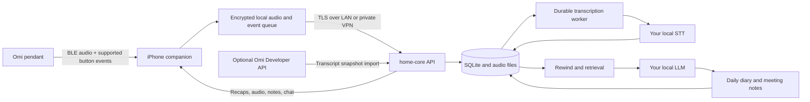

# Architecture

## Goal and ownership

A private personal audio memory system: Omi → iPhone → home-core → your own STT/LLM. The phone is the capture bridge and control surface. Home-core owns the audio archive, transcript timeline, meeting state, diary, retrieval, and chat. Direct capture and local inference need no internet after software and models are installed. Optional personal Developer API import reads existing hosted Omi transcripts into the same archive and needs internet plus a server-side developer key. Away from home, a private VPN can provide access; otherwise capture queues locally and server features catch up after reconnection.

## System map

## User behavior

| Action | Intended result | Starter / dependency |
|---|---|---|
| Wear Omi during the day | Continuous timestamped capture | Native capture implemented; physical endurance acceptance remains |
| Single click | Hint that nearby speech is important | One accepted flag per 60 seconds; context on both sides |
| Click and hold, otherwise double click | Toggle a possible meeting | Prefer verified hold support; double-click is the stock firmware fallback to test |
| Meeting control on phone | Start/stop and show remaining timeout | Native and web controls implemented |
| Forget to end meeting | End at configured duration | Implemented, default 120 minutes, with native countdown |
| Rewind 10 minutes (or chosen X) | Hear original audio and read a short recap | Backend implements both for 1–60 minutes |
| End of day | Recap with events, decisions, commitments and open questions | Scheduled backend recap plus portable diary implemented |
| Ask later | Answer using past recorded evidence and source links | Persistent chat with scoped keyword/optional hybrid retrieval and source playback |

Choose the meeting gesture by capability: **verified click-and-hold → double click → phone control**. Current production source turns off at ~3 seconds and does not emit its defined long-tap event from the active state machine, but does implement double-click notifications. Do not infer hold duration from a release event. Resolve each gesture once: a recognized meeting double-click must not also create important flags from its component taps. Pairing must discover model/firmware/capabilities, and physical timing remains a device acceptance test. See the [source evidence](device-research.md).

Meeting timeout closes the **meeting label**, while ordinary daily capture continues. A later toggle after an expired meeting starts a new meeting. The phone should show a clear active indicator and confirmation, and may notify before expiry. A confirmation vibration through the pendant is conditional on supported hardware.

## Approximate hints and accidental input

Button timestamps are evidence of user intent around that time. They are **not exact speech, topic, or meeting boundaries**, nor proof that a meeting happened. The LLM receives important/meeting hints alongside the surrounding transcript and is instructed to let the spoken content guide interpretation.

- Flags have a default **60-second cooldown from the last accepted flag**, based on capture time. Clicks during the cooldown create no additional flag and do not extend the wait. This policy spans phone/wearable inputs on the one-owner timeline and survives restarts and delayed uploads.
- A marker retrieves **60 seconds before and 60 seconds after** the click by default. Both windows are configurable; nearby audio after the click can therefore receive the hint too.
- A meeting candidate is provisional during its first minute. If its start/stop hint interval is **less than 60 seconds**, it disappears from accepted meeting hints and meeting recaps. Exactly 60 seconds qualifies. The threshold uses the original toggle interval, before context padding; it does not claim the inferred conversation lasted exactly that long.
- Qualified meeting hints include **60 seconds of context before the start press and after the stop press** by default. Start/end fields retain the original toggle timestamps for provenance; `timing: approximate` and `context_start`/`context_end` express the retrieval hint. The window can be tuned, and a future segmentation pass can refine speech/topic boundaries.

Ignored flags and short meeting toggles remain in the raw event history for deterministic replay, while their audio/transcripts remain available for ordinary rewind, diary and chat. They are omitted from accepted hint lists and from the LLM's hint metadata. Policy values are captured with each new event; existing databases migrate with the new defaults. A provisional `active_meeting` can still be shown by the phone to acknowledge the first toggle, without treating it as a confirmed meeting in summaries.

## Capture boundary

The iPhone uses native SwiftUI, CoreBluetooth, libopus and an atomic file-backed journal/outbox. This replaces the initially proposed on-phone SQLite queue while preserving stable IDs, original packets, capture clocks, retry state and recoverable chunks. Codec/model discovery drives decoding rather than the purchased marketing name. UUIDs are assigned before networking and retained on retries. Upload acknowledgements are checked against the original item before it is marked delivered.

The phone preserves compressed source frames and uploads decoded 30-second WAV chunks. The backend accepts mono PCM16 WAV at 16 kHz, max 120 seconds and 4 MB. At this format, 12 hours is about 1.38 GB before compressed originals/metadata. The configurable phone budget defaults to 2 GB; it stops safely rather than deleting unsent data when full. Recent local-buffer rewind works while home-core is unreachable. Summarization/chat still require the owner's local model service to be reachable.

Use capture time, not upload time, throughout. The BLE sequence counter detects loss and wraps; it is not a wall clock. Anchor frames to a monotonic phone clock, persist the wall-clock mapping, and do not stitch across missing frames as though speech were continuous. After reconnect, handle hardware storage import only if the actual model supports a confirmed protocol. Disconnected physical button-event preservation is unconfirmed; a phone queue only protects events already received.

## Bounded contexts and records

The optional Omi adapter fetches `/v1/dev/user/conversations` with transcripts enabled. It validates a bounded page before an atomic write, assigns deterministic local UUIDs from upstream IDs, and records `source_kind=omi_api` plus the original `source_id`. Imported records are already transcribed, have `audio_available=false`, and never enter the STT queue. Their segment timestamps remain relative to the conversation's UTC `started_at`, matching the archive segment format. Repeated imports skip existing IDs to preserve local corrections and retention. Summaries are not imported as evidence. Existing search, diary, chat, retention and backup behavior applies to both input paths. This adapter does not download device storage, provide hosted audio playback, or export local capture to Omi.

| Context | Source record | Derived result |
|---|---|---|
| Capture | Audio UUID, device, UTC bounds, content hash, file | Upload/transcription state and gap coverage |
| Moments | Append-only `mark` events with capture time, cooldown and context policy | Sparse approximate importance hints |
| Meetings | Append-only `meeting_toggle`, capture time, timeout and hint policy | Qualified approximate meeting spans and end reason |
| Diary | Transcript sources, relevant events, timezone, model and prompt version | Version-sensitive daily Markdown and recap |
| Recall | Evidence UUIDs, transcript time range | Scoped keyword/optional hybrid results, audio rewind, grounded chat |
| Inbox | Current transcript revisions and validated character spans | Editable, event-backed proposals and cross-day status |

Meeting state is replayable in event capture order, so delayed uploads and retries do not toggle it twice. One owner/one wearable timeline is assumed. New phone payloads preserve captured timeout/minimum/cooldown values across offline uploads; older payloads use server defaults at delivery. Conflicting policy retries under the same UUID are rejected. Derived closure at a deadline does not depend on a timer surviving process termination. The native app reconciles server state with its pending local events.

SQLite with FTS5 and an optional versioned passage/vector index avoids additional infrastructure. Exact scoped vector scans are streamed and bounded in memory; a different index is a future measured-performance decision. Audio and transcripts remain authoritative; a language model's summary is a derived interpretation. Preserve traceability and allow correction rather than treating inferred facts as established knowledge.

## Summaries and knowledge

Rewind returns original chunk evidence, pending transcription count, missing-audio intervals, optional generated summary, and clipped audio separately. Speech timestamps are chunk-level by default; compatible HTTP STT providers can supply segment timestamps when enabled. A conservative audio-energy silence gate avoids transcribing quiet chunks. Speaker diarization, identification and advanced overlap segmentation remain optional model-dependent improvements.

Daily generation uses the configured local calendar boundaries, including 23/25-hour daylight-saving days. Large days are reduced in batches instead of silently dropping the end of the transcript. Accepted important/meeting hints are passed to the summarizer as approximate context. The diary exports source UUIDs, and late evidence invalidates the cache, including a hint just outside the calendar day whose context overlaps it. Generated diary versions and transcript corrections have history. In-flight inference checks its evidence before persisting output, so corrections/deletions cannot silently restore stale derived content.

Long-term recall uses transcript keywords and local-calendar date scoping, with persistent conversations and source playback. Today/yesterday, ISO dates and English/Danish weekday references scope evidence before retrieval. Broad day questions sample bounded evidence; they do not claim exhaustive semantic recall. Unknown source UUID citations are rejected. Optional local semantic retrieval is implemented but disabled by default. A separate embedding adapter and durable bounded worker backfill versioned passages; independent scoped lexical/semantic candidates are deduplicated and rank-fused. SQL triggers invalidate all derived versions on correction/deletion/expiry, while read/write checks reject stale results. `/v1/search` shares chat retrieval without generating or saving answers. Full transcripts remain authoritative; matching excerpts and retrieval provenance are additive. No particular embedding model or bilingual quality has been validated. See the [retrieval configuration and evaluation contract](README.md#optional-local-semantic-retrieval). Model factual accuracy still needs verification against the evidence.

## Inbox foundation

The inbox is a separate backend context (`inbox_domain`, `inbox_store`, `inbox_jobs`, `inbox_schema`, `inbox_split`, `inbox_api`). SQLite triggers version text changes from STT, direct imports and corrections and invalidate/purge affected derivatives transactionally. Jobs store source IDs, revision tokens and slice bounds, rather than transcript copies. Input fingerprints include timezone, prompt version, model route and bounded context. Claim tokens, leases, retries, revision checks and publish transactions prevent stale workers from restoring corrected/deleted content. The extraction loop is independent of capture/transcription and recap generation.

Machine proposals and user overrides/status are separate. Append-only events record extraction, manual changes, evidence changes and withdrawal. Exact span anchors conservatively reconcile overlapping windows; equal wording on different days is not enough to merge. Duplicate dismissal retains the original item identity. Explicit-null overrides and user statuses survive future proposals. Source deletion/expiry deliberately purges dependent item/event content; audio-only expiry preserves transcript evidence. Backups include the SQLite context and restore tests cover inbox state and pending jobs.

`GET /v1/inbox` supports status/kind/deadline filters and pagination; item detail and PATCH share evidence and optimistic versions across web/native clients. Mutation UUIDs make retrying a lost acknowledgement safe. `POST /v1/inbox/extractions` queues bounded calendar ranges and retries failed work; per-job status plus list coverage expose progress. Native review requires a reachable backend and introduces no persistent inbox cache or capture-outbox dependency. Stable item IDs and events are the foundation for future weekly review/project histories/briefings; those consumers are not implemented here.

## Local deployment boundary

Keep the backend stateful on home-core. Existing HomeCompute repository routes suggest HTTP-compatible STT (`stt-danish` or `whisper-turbo`) and LLM (`home`) behind the local gateway. Those may execute on another machine you own. If inference must run physically on home-core, select or implement the appropriate local CPU/accelerator service; the existing Wyoming service needs an adapter.

No Omi account, Firebase, hosted vector store, commercial STT, or cloud LLM is needed. The official app's local-source build is a possible alternative, but it is not compatible with this backend's API without an adapter. It carries a larger backend/auth schema; see research before choosing a fork.

The backend serves the built responsive web app and API on port 8787. Application authentication is intentionally disabled as requested; no mobile token is used. Credentials for an optional local inference gateway stay outside Git and the frontend. TLS and private VPN access can be configured for the home network without adding cloud dependencies.

Pause, transcript correction, deletion/export and separate audio/transcript retention are implemented. Zero retention days means keep indefinitely. Expiry/deletion clears affected search/derivative data. Backup snapshots verify referenced recording checksums; the CLI supports restore into a fresh directory and optional age encryption. Local model connectivity and physical iPhone/pendant reliability still require the acceptance checks in the reviewed plan.
