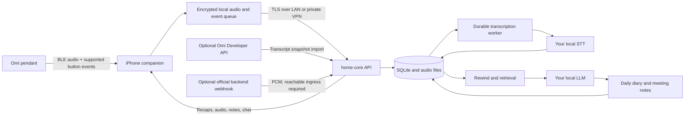

# Architecture

## Goal and ownership

A private personal audio memory system: Omi → iPhone → home-core → your own STT/LLM. The phone is the capture bridge and control surface. Home-core owns the audio archive, transcript timeline, meeting state, diary, retrieval, and chat. Direct capture and local inference need no internet after software and models are installed. Optional personal Developer API import reads existing hosted Omi transcripts into the same archive and needs internet plus a server-side developer key. Away from home, a private VPN can provide access; otherwise capture queues locally and server features catch up after reconnection.

## System map

## User behavior

| Action | Intended result | Starter / dependency |
|---|---|---|
| Wear Omi during the day | Continuous timestamped capture | Native capture implemented; physical endurance acceptance remains |
| Single click | Hint that nearby speech is important | One accepted flag per 60 seconds; context on both sides |
| Click and hold, otherwise double click | Toggle a possible meeting | Prefer verified hold support; double-click is the stock firmware fallback to test |
| Meeting control on phone | Start/end and show the active meeting | Native and web controls implemented |
| Forget to end meeting | After the first hour, end after recorded quiet | Fixed 10 minutes of continuous verified quiet; no duration cap |
| Rewind 10 minutes (or chosen X) | Hear original audio and read a short recap | Backend implements both for 1–60 minutes |
| After transcription | Day-so-far recap with events, decisions, commitments and open questions | Automatic backend recap plus portable diary implemented |
| Ask later | Answer using past recorded evidence and source links | Persistent chat with scoped keyword/optional hybrid retrieval and source playback |

Choose the meeting gesture by capability: **verified click-and-hold → double click → phone control**. Current production source turns off at ~3 seconds and does not emit its defined long-tap event from the active state machine, but does implement double-click notifications. Do not infer hold duration from a release event. Resolve each gesture once: a recognized meeting double-click must not also create important flags from its component taps. Pairing must discover model/firmware/capabilities, and physical timing remains a device acceptance test. See the [source evidence](device-research.md).

Automatic closure ends the **meeting label**, while ordinary daily recording continues. Quiet starts counting only after the meeting's first hour: the fixed ten-minute wait can therefore close it no earlier than 70 minutes after its start, plus the 30-second evidence settling buffer. Meeting auto-end is not configurable; legacy saved quiet-period values are ignored. Missing uploads, capture gaps, speech, unknown detection, imports and receipt-timed webhooks cannot prove continuous quiet. Manual end works at any time. The phone shows an active indicator and confirmation; pendant vibration depends on supported hardware.

Quiet evidence must belong to the meeting's capture device. Web starts preserve `device_id: web` provenance and can explicitly bind `meeting_capture_device_id` to one fresh, actively reporting pendant; ambiguous or unavailable sources require manual end. iPhone microphone recordings remain local until finished and uploaded as files, so they do not provide live quiet evidence for automatic closure.

## Approximate hints and accidental input

Button timestamps are evidence of user intent around that time. They are **not exact speech, topic, or meeting boundaries**, nor proof that a meeting happened. The LLM receives important/meeting hints alongside the surrounding transcript and is instructed to let the spoken content guide interpretation.

- Flags have a fixed **60-second cooldown from the last accepted flag**, based on capture time. Clicks during the cooldown create no additional flag and do not extend the wait. This policy spans phone/wearable inputs on the one-owner timeline and survives restarts and delayed uploads.
- A marker retrieves a fixed **60 seconds before and 60 seconds after** the click; nearby audio after the click can therefore receive the hint too.
- A meeting candidate is provisional during its first minute. If its start/stop hint interval is **less than 60 seconds**, it disappears from accepted meeting hints and meeting recaps. Exactly 60 seconds qualifies. The threshold uses the original toggle interval, before context padding; it does not claim the inferred conversation lasted exactly that long.
- Qualified meeting hints include a fixed **60 seconds of context before the start press and after the end**. Start/end fields retain the original intent or observed closure timestamps for provenance; `timing: approximate` and `context_start`/`context_end` express the retrieval hint. A future segmentation pass can refine speech/topic boundaries.

Ignored flags and short meeting toggles remain in the raw event history for deterministic replay, while their audio/transcripts remain available for ordinary rewind, diary and chat. They are omitted from accepted hint lists and from the LLM's hint metadata. Legacy timeout/minimum/cooldown snapshots remain stored for retry identity, but cannot override the fixed rules. A provisional `active_meeting` can still be shown by the phone to acknowledge the first toggle, without treating it as a confirmed meeting in summaries.

## Importance after capture

`GET /v1/importance` and idempotent `PUT /v1/importance` manage explicit user marks for existing sources, qualified meetings, person/project labels, and immutable diary versions or their section text. Web and native controls share these marks through home-core. They are metadata separate from raw capture gestures and do not rewrite capture timestamps, evidence versions, or inferred claims. Section text is checked against its saved recap and remains tied to that version after regeneration. SQLite cleanup follows source, label and diary-version deletion; label merges transfer the mark to the surviving label. Archive backups include marks, and purging diary history also removes stored section text.

## Capture boundary

The iPhone uses native SwiftUI, CoreBluetooth, libopus and an atomic file-backed journal/outbox. This replaces the initially proposed on-phone SQLite queue while preserving stable IDs, original packets, capture clocks, retry state and recoverable chunks. Codec/model discovery drives decoding rather than the purchased marketing name. UUIDs are assigned before networking and retained on retries. Upload acknowledgements are checked against the original item before it is marked delivered.

The phone preserves compressed source frames and uploads decoded 30-second WAV chunks. The backend accepts mono PCM16 WAV at 16 kHz, max 120 seconds and 4 MB. At this format, 12 hours is about 1.38 GB before compressed originals/metadata. The configurable phone budget defaults to 2 GB; it stops safely rather than deleting unsent data when full. Recent local-buffer rewind works while home-core is unreachable. Summarization/chat still require the owner's local model service to be reachable.

Use capture time, not upload time, throughout. The BLE sequence counter detects loss and wraps; it is not a wall clock. Anchor frames to a monotonic phone clock, persist the wall-clock mapping, and do not stitch across missing frames as though speech were continuous. After reconnect, handle hardware storage import only if the actual model supports a confirmed protocol. Disconnected physical button-event preservation is unconfirmed; a phone queue only protects events already received.

## Android companion

The Android app embeds the existing responsive archive interface and uses a native foreground
service for phone microphone and Omi BLE capture. It shares the same WAV, events, capture-state,
and gap API contracts. A private per-chunk journal preserves its preallocated UUID, capture clock,
profile and endpoint snapshot. Completed 30-second chunks upload with persisted JobScheduler
retries; receipt validation precedes local deletion. Queue recovery excludes writers still owned
by the live service. The WebView exposes no JavaScript/native bridge. See the
[Android guide](../src/android/README.md) for build steps, capture policy, platform differences,
and physical acceptance checks.

## Location context

Opt-in phone observations attach to audio chunks before upload through the durable outbox. Latitude,
longitude, horizontal accuracy and observation time are capture metadata, separate from transcript
claims and spoken destinations. Stale/unusable fixes are omitted, retries preserve the original
observation, and recording deletion/transcript expiry removes location from the active archive.
Native capture sessions request bounded-accuracy background updates only while enabled and connected.

Decision follow-ups can propose undated arrival/departure reminders with exact cited place phrases.
The owner resolves the actual place on iPhone; EventKit saves the confirmed geofence in Apple
Reminders. The backend neither resolves ambiguous places nor monitors the phone's movements.
Calendar events keep their location in the native editor; portable exports reject proximity alerts.
See [location behavior, API and physical acceptance](location-support.md).

Zone definitions are per-profile archive records with stable UUIDs and versioned edits. Each zone
contains multiple labeled circles with independent radii. Query-time spatial matching uses recording
locations (a manual edit takes precedence over captured GPS); zone edits reclassify existing
recordings without changing evidence or retry receipts. Filters run before counting, grouping and paging and retain their scope through
expanded recording groups. Full-day summaries remain unfiltered and are explicitly distinguished
from the selected recording filter. Zone definitions are included in archive backups.

`GET/PUT /v1/sources/{id}/location` lets the owner add or correct a recording's place, including
imported recordings without GPS. Assignments accept only saved zone/place UUIDs. The server resolves
them in the current profile under the write transaction and rejects arbitrary names/coordinates.
A separate versioned `source_locations` row stores the selected IDs and a historical name/coordinate
snapshot; `source_metadata.location` and capture/retry identity remain unchanged.
Reads expose `manual_location` separately. Writes check `expected_version`; writing `location: null`
restores captured GPS (or no location). Source deletion and expiry remove manual places, and archive
backups include them. Web and iPhone recording details expose tag and location actions directly.
Transcript and recap source views reuse these controls. A searchable picker applies a saved place
on selection and links to saved-place management, with an explicit empty state.

Conversation tags are separate user-owned categories attached to stable source UUIDs. A group edit
resolves its complete unfiltered day membership under one transaction and checks a membership
fingerprint plus a tag revision. Later uploads do not inherit tags implicitly. Queries combine tag
and zone filters before paging, while raw capture coordinates, source versions and transcripts
remain unchanged. Deletion/expiry removes assignments, and archive backups preserve the vocabulary
and remaining links. See [conversation tag scope and API](conversation-tags.md).

## Optional official audio receiver

`POST /v1/integrations/omi/audio` accepts token-protected official PCM webhooks into the existing durable worker/archive. It validates bounded aligned 8/16 kHz input, converts to archive WAV, and commits audio plus a transactional retry receipt before HTTP 200. Each request remains its own source, with `source_kind=omi_audio_webhook`, supplied account UID and sample metadata. Bounds estimate a chunk ending at server receipt; no capture clock/device/session sequence is supplied. Coverage keeps these estimates separate and does not remove unknown capture intervals. Matching `(uid, Idempotency-Key)` retries reuse acceptance, including after retention/deletion; unkeyed requests remain separate. Inference stays outside the request path.

Current upstream sends from Omi’s backend and blocks private destinations. Hosted delivery requires separately provisioned HTTPS access to only this endpoint; phone LAN/VPN reachability alone is insufficient. The archive API/UI stays private and unauthenticated. This task provisions no ingress. See [the verified contract, setup, timing/duplicate/concurrency policies and physical checks](official-audio-forwarding.md). Forwarding does not establish cloud-free operation or continuous capture.

## Bounded contexts and records

### Recording vendors and import adapters

Brand identity is independent of transport. `vendor_catalog.py` declares each brand's stable ID,
display name, setup instructions, and capabilities (`file_upload`, `transcript_import`,
`transcript_export`, `local_capture`, `audio_webhook`). Web and native audio import pickers read
`GET /v1/vendors`; adding an audio-export brand requires a catalog entry and translations.
Catalog entries advertise implemented paths, never inferred Bluetooth compatibility.

Cloud transcript adapters inherit `TranscriptAdapter` in `vendor_imports.py` and implement
`fetch_page(VendorImportRequest) -> VendorPage`. They return `VendorRecording` values containing
the upstream ID, original timezone-aware capture bounds, original speech, and optional relative
transcript segments. Missing/unfinished transcripts return `None`. Adapters own vendor wire
formats, authentication and pagination; the shared importer validates the complete page, commits
atomically, indexes speech, and preserves local edits and retention on retries. Stable UUIDs use
the adapter's identity namespace plus upstream ID. Deletion tombstones include source kind and
upstream ID, so deleting one brand's recording never suppresses another brand's same upstream ID.
Imported transcripts are completed conversations with no playable audio; vendor summaries do
not enter source evidence. New cloud adapters add a backend-only `SecretStr` setting and register
in `ProfileRuntime.vendors`; credentials use the existing private configuration editor and are
excluded from archive exports. Pagination must advance and remote reads must remain bounded,
use fixed official HTTPS endpoints, and reject redirects without exposing upstream diagnostics.

`POST /v1/vendors/{id}/import` imports one bounded cloud page into the selected profile.
Omi retains its existing routes and deterministic recording IDs. Pocket uses its official public
list/detail endpoints and `recording_at` plus duration, with exact local date filtering over the
API's UTC-day filters. This imports hosted transcripts; it does not pair with Pocket hardware.

Plaud uses `POST /v1/vendors/plaud/import-export` with SRT/TXT transcript content, explicit original
`started_at`/`ended_at`, and an optional upstream `source_id`. With no ID, retry identity hashes
the unchanged export and capture bounds; changed exports require the original ID to deduplicate.
Plaud's documented consumer access does not provide a general API-key REST contract, so no
invented Plaud credential or private endpoint is used. See the official [export formats](https://support.plaud.ai/hc/en-us/articles/51023259082393-Export-recordings-transcripts-and-summaries)
and [API availability](https://support.plaud.ai/hc/en-us/articles/60726890231449-How-can-I-get-API-access-to-my-Plaud-data).

Exported audio retains `source_kind=manual_upload`, its filename, and the selected
`source_metadata.vendor_id`. The upload plan captures that brand before transfer and validates
it for every chunk. Retrying an interrupted upload keeps its original brand, IDs and times even
if another client selects a different brand. Existing plans and clients default to manual upload.
Apple Voice Memos, Sony and Zoom recorders are supported through audio export; direct hardware
capture for those brands is not implemented. Supported codecs and audio limits are unchanged.

The optional Omi adapter fetches `/v1/dev/user/conversations` with transcripts enabled. It validates a bounded page before an atomic write, assigns deterministic local UUIDs from upstream IDs, and records `source_kind=omi_api` plus the original `source_id`. Imported records are already transcribed, have `audio_available=false`, and never enter the STT queue. Their segment timestamps remain relative to the conversation's UTC `started_at`, matching the archive segment format. Repeated imports skip existing IDs to preserve local corrections and retention. Summaries are not imported as evidence. Existing search, diary, chat, retention and backup behavior applies to both input paths. This adapter does not download device storage, provide hosted audio playback, or export local capture to Omi.

| Context | Source record | Derived result |
|---|---|---|
| Capture | Audio UUID, device, UTC bounds, content hash, file | Upload/transcription state and gap coverage |
| Moments | Append-only `mark` events with capture time, cooldown and context policy | Sparse approximate importance hints |
| Meetings | Append-only `meeting_toggle`, capture time, explicit start/end intent and capture-device association | Qualified approximate meeting spans and end reason |
| Diary | Transcript sources, relevant events, timezone, model and prompt version | Version-sensitive daily Markdown and recap |
| Weekly review | Adjacent local-calendar weeks of original transcripts, coverage, evidence fingerprint | Immutable cited items, historical versions, durable on-demand jobs |
| Recall | Evidence UUIDs, transcript time range | Scoped keyword/optional hybrid results, audio rewind, grounded chat |
| Inbox | Current transcript revisions and validated character spans | Editable, event-backed proposals and cross-day status |
| Manual labels | User-managed person/project UUIDs, explicit source-version associations, cited annotations and decision-register IDs | Dated cross-day timelines with correction review; no inferred identity or participation |
| Conversation preparation | Literal subject/aliases, selected source content versions and separately supplied user context | Ephemeral structured brief with exact cited excerpts; no new persistent records |

Meeting state is replayable in event capture order, so delayed uploads and retries do not apply an event twice. One owner/one wearable timeline is assumed. New web and iPhone events include `meeting_intent: start|end`; end also names `meeting_id`, so a delayed end of an automatically closed meeting cannot open another one. The server snapshots the optional capture-device association in the existing event policy JSON. All meetings use the fixed ten-minute quiet rule; legacy timing values remain stored only for upload compatibility. Conflicting retry metadata under the same UUID is rejected. Automatic closure is derived from recorded evidence, without a process timer or elapsed-duration deadline; evidence corrections can change the derived boundary. The native app reconciles server state with its pending local events.

SQLite with FTS5 and an optional versioned passage/vector index avoids additional infrastructure. Exact scoped vector scans are streamed and bounded in memory; a different index is a future measured-performance decision. Audio and transcripts remain authoritative; a language model's summary is a derived interpretation. Preserve traceability and allow correction rather than treating inferred facts as established knowledge.

LLM routes resolve by task: chat answers, summaries, extraction (inbox/decisions), conversation preparation, and weekly reviews. Every route inherits the shared local LLM configuration unless explicitly overridden; model, endpoint, token and deployment revision can vary independently. Credentials stay behind the inference adapter and out of provenance/cache identities. Summaries and weekly caches fingerprint their own route, while extraction jobs record the extraction route identity. Large chat uses the summary route for intermediate evidence reduction and the chat route for its final answer, avoiding a redundant final-summary round trip. Broad recall samples source IDs before loading selected transcript bodies outside the event loop; it remains sampled recall, not exhaustive coverage.

Chat additionally has a retrieval route for bounded alternate wording after an initial miss, inheriting the same model by default. Successful retrieval needs no planning call. Short follow-ups reuse topical context without generation; scope parsing always uses the original question and saved scope. Lexical and semantic branches run concurrently, query vectors are cached/coalesced by immutable model contract in bounded RAM, and interactive deadlines/cooldown keep embedding failures from repeatedly stalling answers. Search results and generated answers are never cached by this optimization. Multiple non-overlapping excerpts preserve distant relevant details within the shared evidence budget.

The JSON chat route remains available. Web/native clients use a separate NDJSON stream with provisional text and a terminal validated result. One bounded queue handles backpressure; disconnection cancels model work and closes upstream streams. Only a complete answer with allowed citations and current source versions reaches the existing transactional save. Both clients discard failed/cancelled drafts; the native stream uses an ephemeral URLSession and stores only final exchanges in its existing cache. In-flight timing metadata separates search, optional rewriting, generation and first-token latency. Absolute answer quality and hardware throughput still require a reachable local deployment.

## Summaries and knowledge

Completed nonempty transcripts receive a recording title and consecutive subject chapters from the
local summary model. Multipart uploads are analyzed together after all parts finish; nearby live
chunks from the same stream share context. A live stream gets a 60-second settling period before
analysis, which schedules navigation without establishing conversation closure. Long transcripts
use bounded windows with the preceding subject and transcript tail as context; an explicit
continuation decision joins a subject even when the model phrases its title differently.
Upload limits, processing windows, speaker changes and language switches do not define subjects.
Exact, unique transcript phrases anchor boundaries, and chapters are intersected with original
source text to retain complete, local character spans. Shared chapter IDs let web and iPhone
Today views open one subject across several audio parts, independently of member pagination.
Exact audio seeking is available only when validated STT segment boundaries align with the
passage; otherwise navigation uses its original transcript and recording interval.
A separate background consumer backfills existing recordings without repeating transcription.
Analysis is cached by prompt/model/language and the versions of every source in its context.
Dependencies in `recording_topic_sources` invalidate sibling chapters on correction, deletion or
transcript expiry; atomic publication rejects evidence or grouping changes during generation.
Recap preparation shares this cached subject map, sends exact per-subject transcript copies with
original UUIDs, and treats titles as navigation hints rather than facts. Daily synthesis merges
continued subjects across recordings under specific headings while retaining source citations.
The source UUID, capture bounds, audio and canonical transcript remain unchanged.

Rewind returns original chunk evidence, pending transcription count, missing-audio intervals, optional generated summary, and clipped audio separately. Speech timestamps are chunk-level by default; compatible HTTP STT providers can supply segment timestamps when enabled. Local speech filtering is enabled by default for STT copies, retaining padded speech spans and original source offsets; full archive audio is unchanged. Detection failure retains the entire request, and the old RMS floor remains a separate explicit opt-out from preserve-quiet mode. Optional speaker diarization processes complete meeting/conversation audio in a separate local Community-1 service. SQLite stores anonymous turns, user-assigned names and correction events separately from canonical transcripts; version checks reject concurrent edits and stale evidence. Playback joins original intervals for one speaker. Source deletion/transcript expiry removes dependent speaker metadata, and profiles retain separate assignments. Optional remembered voices use only explicit confirmed enrollment, clean speech embeddings and immutable weights/code fingerprints. Suggestions require two independent confirmed conversations and an exact-gallery held-out evaluation report, then user confirmation. Audio retention, deletion and corrections remove dependent examples; duplicate source evidence cannot count twice. Automatic naming and simultaneous-speaker separation remain unimplemented.

STT requests use pieces bounded by `stt_chunk_seconds` (default 30, configurable from 1–120 seconds) to fit speech providers whose duration limit is shorter than the archive's 120-second upload limit. Near each maximum, the splitter searches up to `stt_boundary_search_seconds` (default 5) for the clearest pause; absent a pause it uses the maximum. The setting applies live to subsequent processing and must fit every configured speech route; audio limits are not automatically inferred from gateway model metadata. The original recording, source ID and capture bounds stay intact; text is joined in order and segment timestamps are offset into the original recording. All pieces must succeed before publishing a transcript, and all requests share the recording's inference deadline.

The local WebRTC detector checks original and amplified frames. STT copies retain detected speech with 300 ms context, merging padded spans separated by at most 200 ms. Unobserved tails and unknown/invalid detection fail open. Copies use capped uniform gain and may move internal boundaries into quiet gaps within a retained span; source offsets remain authoritative. An optional local FFmpeg pass runs only after all original passes succeed, within the remaining deadline and one bounded cleanup budget. Its mild noise reduction/leveling compensates filter delay and validates sample count. Original transcripts remain canonical even when empty; separate enhanced readings in `transcription_details` require an audited correction before entering search or model evidence. Candidates follow transcript correction/retention/deletion and SQLite archive backups. Missing FFmpeg, malformed output, timeouts and failed candidate recognition never fail a completed original pass. Web source details expose review alongside original playback. See [the reviewed plan](audio-processing-plan.md) and [operations](README.md#speech-processing-and-cleanup-review).

`usage.py` persists profile-local audio-filter observations and provider attempts in the archive database, without prompts or raw audio. Pending attempts are saved before outbound requests; settlement metadata finalizes known credit charges. Retries and optional language/cleanup passes add submitted minutes without recounting captured recordings. Summary run IDs bind lexical filtering to the same inference adapter and usage ledger. Each logical summary pass records original/retained characters, skipped input and the union of its selected original recording intervals in minutes, including empty placeholders representing cached conversation notes. Missing duration remains explicitly incomplete. Source minutes count once per pass before filtering and do not imply billable summary audio. Actual outbound attempts record submitted text size and provider-reported tokens. Request counts/text include retries, while operation receipts deduplicate billed credits and tokens. Original audio/transcripts remain authoritative; no prompt or response text enters usage storage. Reports retain unknown billing/token measurements explicitly and survive archive backups/deletion. `GET /v1/usage` and Settings → Audio & credit usage default to the current month in the archive timezone, with `?month=YYYY-MM` and a month picker selecting another month. Totals, completeness notices and all daily rows follow that month; global receipt deduplication still prevents charges being counted again across month boundaries.

STT routes resolve by the selected language, with exact regional then base-language matching and shared model/endpoint/token defaults. In automatic mode, configured language routes enable a multilingual first pass requesting language metadata; a matching different route performs at most one specialist pass on the same WAV piece. Unknown/missing language metadata retains the first result. Both passes share one deadline, and only the final transcript/segments enter the existing source record and revision checks. Specialist failure leaves the recording on the durable retry path. Routing is per piece, not per speaker or code-switched segment; local endpoint validation and backend-only credentials apply to every route.

Web and native settings share a configuration API with editable descriptors derived from the backend schema, excluding retired flag/meeting timing, shared pause and recap scheduling preferences. Legacy fields remain accepted for compatibility; the fixed rules ignore them. Reads redact top-level and route credentials and expose only configured status; partial writes preserve omitted secrets and use a revision to reject conflicting edits. Ordinary preferences remain in SQLite. Service overrides and keys are written atomically to an owner-only private file in the bootstrap archive directory, excluded from application archive export. Transcription, summary/chat and integration key edits activate for subsequent work; embedding contracts, worker startup and storage/web paths are staged until process restart. Archive-path edits select an archive rather than migrating its records.

Uploaded recordings and finished transcript imports become eligible for the daily recap as soon as transcription is complete. Live conversations wait for a fixed five minutes of contiguous observed non-speech, followed by the 30-second settling buffer. Transcription continues while speech is ongoing; the whole live conversation stays pending until this pause is established. Resumed speech resets the pause, and missing uploads, capture gaps and detector failures cannot establish silence. A live pause can qualify for the diary even when its meeting label remains open; speaker grouping keeps its separate meeting policy. Multipart files wait for every part to arrive and finish transcription. A finished file can qualify before its matching live alternative; their evidence is merged once both are eligible.

Automatic generation batches eligible evidence for 15 seconds without upload/transcription changes, waiting for known pending file uploads for up to 60 seconds. Ongoing live speech neither resets an eligible upload's timer nor becomes eligible through that timer's maximum wait. The independent consumer checks every five seconds; model processing and client polling add latency. Restarting reconstructs work from the archive and restarts the short batching window. Additional independent eligible recordings during inference leave the selected snapshot valid and the saved recap stale for the next update; changed selected evidence or a reopened live boundary still rejects publication.

Daily generation uses the configured local calendar boundaries, including 23/25-hour daylight-saving days. Large days are reduced in batches instead of silently dropping the end of the transcript. Accepted important/meeting hints are passed to the summarizer as approximate context. The diary exports source UUIDs, and late evidence invalidates the cache, including a hint just outside the calendar day whose context overlaps it. Generated diary versions and transcript corrections have history. In-flight inference checks its evidence before persisting output, so corrections/deletions cannot silently restore stale derived content.

Web weekly reviews compare one Monday–Sunday calendar week with its predecessor without requiring daily summaries. A separate single-consumer SQLite job queue performs bounded original-evidence extraction and reduction; typed JSON candidates retain exact source quotes, dates and week roles. Intermediate resolution observations preserve explicit completion/cancellation across batches. Final commitments remain explicitly open or follow-through unconfirmed; absence is never completion. Recurrence and changes require distinct dated original evidence. The full source snapshots remain with immutable versions, while client source inspection resolves current transcripts. Mechanical citation checks cannot establish semantic accuracy.

Weekly fingerprints cover both windows, coverage/gaps, contextual events, timezone, prompt and model configuration. Reads expose live staleness; forced regeneration adds a version. Publication verifies the fingerprint under the archive write lock. Archive deletion/transcript-expiry triggers atomically purge all weekly derived content and jobs; filesystem pruning also removes restored weekly Markdown projections. Backup renders version projections from the same pinned database snapshot, and restore validates their UUID filenames. The consumer recovers interrupted attempts and sanitizes failure state. Scheduling, native weekly reading and consumption of the existing structured inbox state are separate follow-ons; that read interface must include explicit lifecycle provenance and original evidence. Weekly synthesis currently uses original transcripts and does not read or mutate accepted inbox status or decision records.

Long-term recall uses transcript keywords and local-calendar date scoping, with persistent conversations and source playback. Today/yesterday, ISO dates and English/Danish weekday references scope evidence before retrieval. Broad day questions sample bounded evidence; they do not claim exhaustive semantic recall. Unknown source UUID citations are rejected. Optional local semantic retrieval is implemented but disabled by default. A separate embedding adapter and durable bounded worker backfill versioned passages; independent scoped lexical/semantic passages are rank-fused with recording diversity. Token-aware sentence/topic chunks preserve exact transcript offsets; staged publication and attempt leases keep replacements atomic. Context expansion across sources requires explicit grouping. Optional bounded reranking preserves fused fallback. SQL triggers invalidate all derived versions on correction/deletion/expiry, while read/write checks reject stale results. `/v1/search` shares chat retrieval without generating or saving answers. Full transcripts remain authoritative; matching excerpts and retrieval provenance are additive. No particular embedding model or bilingual quality has been validated. See the [retrieval configuration and evaluation contract](README.md#optional-local-semantic-retrieval). Model factual accuracy still needs verification against the evidence.

## Inbox foundation

The inbox is a separate backend context (`inbox_domain`, `inbox_store`, `inbox_jobs`, `inbox_schema`, `inbox_split`, `inbox_api`). SQLite triggers version text changes from STT, direct imports and corrections and invalidate/purge affected derivatives transactionally. Jobs store source IDs, revision tokens and slice bounds, rather than transcript copies. Input fingerprints include timezone, prompt version, model route and bounded context. Claim tokens, leases, retries, revision checks and publish transactions prevent stale workers from restoring corrected/deleted content. The extraction loop is independent of capture/transcription and recap generation.

Machine proposals and user overrides/status are separate. Append-only events record extraction, manual changes, evidence changes and withdrawal. Exact span anchors conservatively reconcile overlapping windows; equal wording on different days is not enough to merge. Duplicate dismissal retains the original item identity. Explicit-null overrides and user statuses survive future proposals. Source deletion/expiry deliberately purges dependent item/event content; audio-only expiry preserves transcript evidence. Backups include the SQLite context and restore tests cover inbox state and pending jobs.

`GET /v1/inbox` supports status/kind/deadline filters and pagination; item detail and PATCH share evidence and optimistic versions across web/native clients. Mutation UUIDs make retrying a lost acknowledgement safe. `POST /v1/inbox/extractions` queues bounded calendar ranges and retries failed work; per-job status plus list coverage expose progress. Native review requires a reachable backend and introduces no persistent inbox cache or capture-outbox dependency. Stable item IDs and events are the foundation for future weekly consumption of accepted inbox state, project histories and briefings. The separate on-demand weekly review currently synthesizes original transcripts directly.

## Manual conversation preparation

`conversation_prep.py` owns deterministic Unicode-casefolded literal retrieval and bounded generation; `prep_models.py` defines strict request/output contracts. Its three POST endpoints are independent of persistent chat and natural-language date parsing. The user confirms individual recordings and the latest relevant source. Existing inbox statuses, decision records and optional hybrid retrieval remain separate; this flow deliberately reads only original transcripts. This release intentionally does not infer discussion groups, canonical entities, verified participants or commitment state.

A SQLite read snapshot fingerprints all audio projections and capture gaps in the searched date range, not only the selected top results. This catches late/new evidence, corrections, deletion, retention, pending work and timezone changes before/after inference. Pagination does not alter snapshot identity. This conservative check can invalidate a prep because unrelated evidence changed. Retrieval scans retained text locally rather than introducing a separate search service; large-archive performance remains to be measured.

The model receives bounded selected excerpts and user context in distinct fields. Each structured output item must quote a contiguous excerpt actually supplied to the model and cite a selected current UUID. The backend attaches source content versions, authoritative dates and segment bounds only when a real segment contains that excerpt. Suggestions remain their own section; commitment owner and completion status are unknown. Structural checks do not establish semantic entailment or model quality.

Responses use `Cache-Control: no-store`; the native prep client uses an ephemeral URLSession. Both prep screens own their drafts in memory and ignore superseded requests. Focus/foreground verification hides evidence while it is checked and removes stale sources/derived items on failure or mismatch. Transcript-only imports remain usable. Source details expose transcript correction; native prep invalidates after its own correction. No disconnected device can receive deletion events, so freshness verification requires backend reachability.

Future entities can resolve a subject to stable IDs plus explicit alias/ambiguity choices, while retaining the literal subject contract. A future commitment reader can attach versioned statuses with independent evidence or separately labeled user assertions. A local hybrid retrieval adapter can supply source IDs and match explanations while keeping latest-by-time ordering independent of relevance scores. Saved context/history requires its own revision, deletion and synchronization contract before persistence; calendar prefilling must remain optional.

## Local deployment boundary

Keep the backend stateful on home-core. Existing HomeCompute repository routes suggest HTTP-compatible STT (`stt-danish` or `whisper-turbo`) and LLM (`home`) behind the local gateway. Those may execute on another machine you own. If inference must run physically on home-core, select or implement the appropriate local CPU/accelerator service; the existing Wyoming service needs an adapter.

No Omi account, Firebase, hosted vector store, commercial STT, or cloud LLM is needed. The official app's local-source build is a possible alternative, but it is not compatible with this backend's API without an adapter. It carries a larger backend/auth schema; see research before choosing a fork.

The backend serves the built responsive web app and API on port 8787. Application authentication is intentionally disabled as requested; no mobile token is used. Local inference remains the default. Compatible hosted HTTPS endpoints can be explicitly configured for transcription, language models and embeddings; they receive the corresponding audio, prompts/transcripts or embedding inputs. Provider API keys and route keys stay on the backend, outside Git, API reads and archive exports. STT/LLM credentials resolve from route key to provider API key to shared gateway key; an explicitly empty key disables authentication. TLS and private VPN access can be configured for the home network without adding cloud dependencies.

Pause, transcript correction, deletion/export and separate audio/transcript retention are implemented. Default retention is 7 days for audio and 30 days for transcripts, selectable in both web and iPhone Settings. Zero retention days means keep indefinitely. Expiry/deletion clears affected search/derivative data. Backup snapshots verify referenced recording checksums; the CLI supports restore into a fresh directory and optional age encryption. Local model connectivity and physical iPhone/pendant reliability still require the acceptance checks in the reviewed plan.

## Completeness and evidence repair

SQLite stores first ingestion/processing times, typed capture transitions, latest sequenced phone observations, output evidence metadata and bounded feedback/resolution records. The clients display observation age and separate playback/transcript interval unions. Source selection, final-prompt UUID references and citation counts are provenance rather than accuracy scores. Feedback invokes explicit existing repairs; source deletion/transcript retention conservatively purge derived notes. See [the implemented contracts and limits](completeness-feedback.md).

Today displays profile-wide recording and processing activity on web and iPhone. `/v1/status`
keeps audio chunk counts in `processing`, and exposes queued/running generation tasks with
`summarizing`, `organizing` and `translating` stage counts in `generation`. Pending recording
topic analysis is counted separately from transcription; active analysis is counted once.
Background recap/topic activity is observed in memory and cleared on completion, failure or
cancellation. Durable generation jobs retain their existing restart behavior. Phone reports
optionally identify `capture_source` (`omi`, `phone`, or the legacy default `unknown`). Live
recording requires a fresh capturing report and audio evidence near the report timestamp;
the native app can also show its current local recording state without a backend connection.

## Manual people/project timelines

Labels reuse `audio.source_version` for source incarnation and transcript evidence; they do not introduce another audio revision column. Collection revisions protect manual edits and pagination, while a separate destructive-archive token reconciles native day/chat caches after reconnecting. SQL lifecycle guards purge dependent annotations/history and canonical decision associations without changing the existing decision, inbox, semantic or weekly contracts. Source picker pagination keeps older recordings reachable.

Personal decision notes have no structured register status. Explicit label-to-decision associations store only canonical decision ID/version and resolve the live register projection; they never copy or confirm decision content. Merge/split/delete operate on these organizational associations while preserving canonical register records. No label is injected into generation, preparation, speaker identification or commitment ownership.
